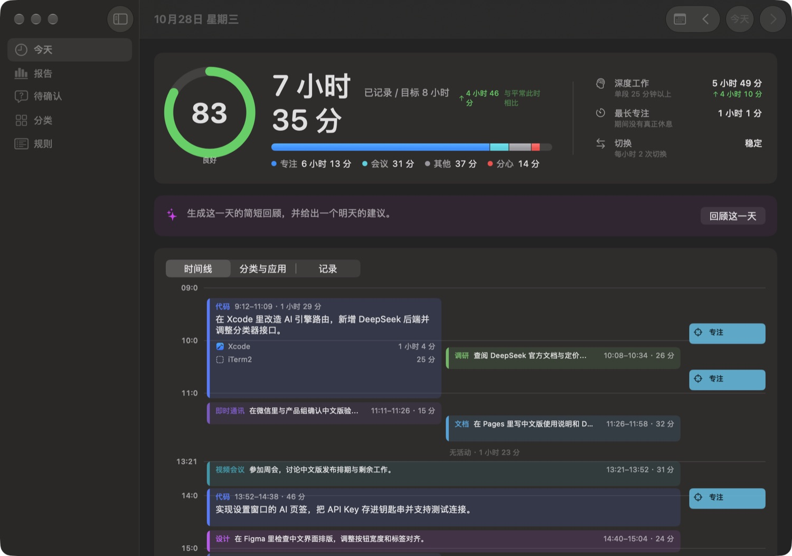
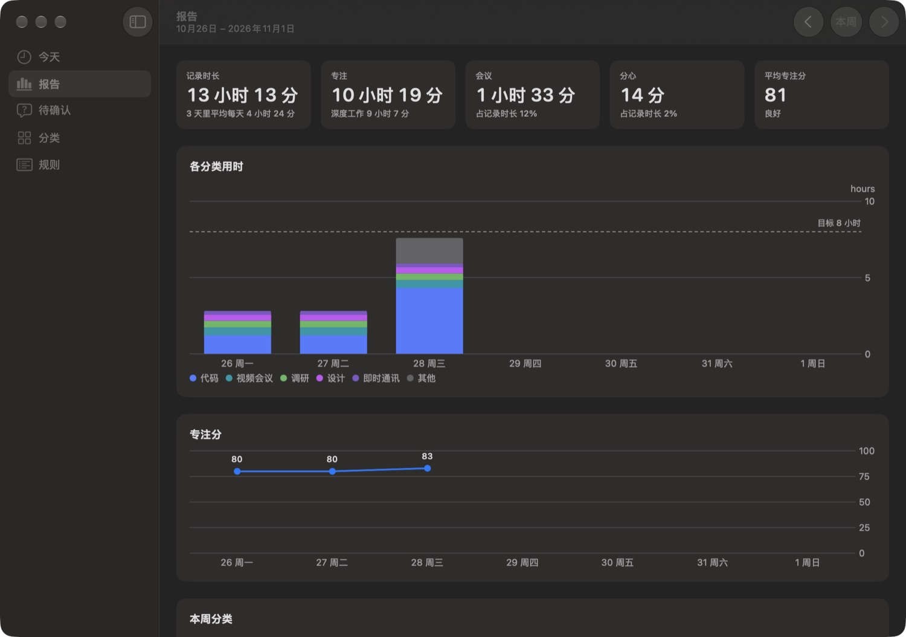
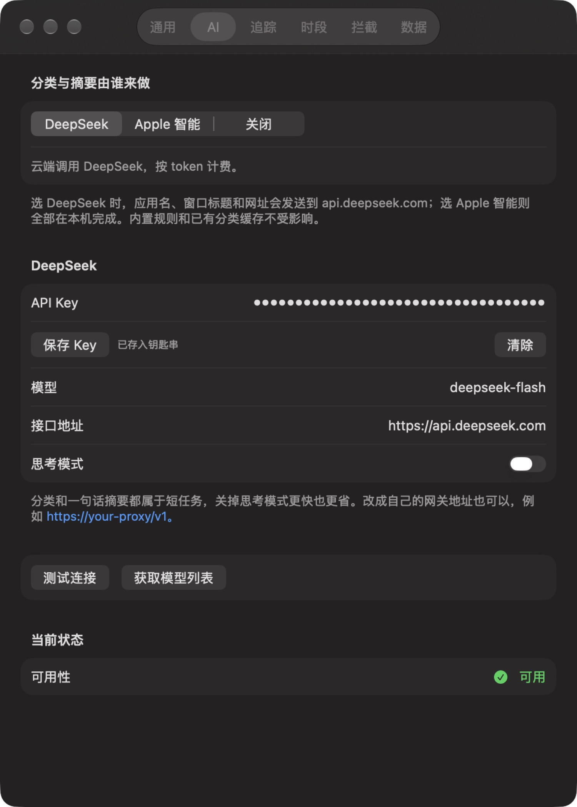

# Weft（中文版）

**看清楚一天的时间到底去哪了，而数据一步都不离开你的 Mac。**

Weft 是一款免费开源的时间追踪工具，常驻在 Mac 的菜单栏。它会记下你正在用的应用、窗口和网站，把时间归到「代码」「会议」「社交媒体」这类分类里，然后把一天画成几条并行的工作流。

Weft 受了 [Rize](https://rize.io) 的启发，但出发点是另一个：人很少一次只做一件事。你写着代码，顺手看一眼文档，回一条消息，再回到代码。所以 Weft 不给你一份「应用切换日志」，而是显示你反复回到的那几条线索。

> 本仓库是 [tiann/weft](https://github.com/tiann/weft) 的简体中文分支：界面全面汉化，并新增 DeepSeek 作为默认 AI 后端。英文说明见 [README.en.md](README.en.md)，与原版的差异见[与原版的区别](#与原版的区别)。

## 界面

**今天** —— 时间线按分类并行展开，每条工作流配一句话摘要。



**报告** —— 一周的记录时长、专注分走势和分类拆解。



**设置 → AI** —— 默认走 DeepSeek，也可以切回 Apple 设备端模型或直接关闭。



> 以上截图使用演示数据，不含任何真实使用记录。

## 与原版的区别

| | 上游 [tiann/weft](https://github.com/tiann/weft) | 本分支 |
| --- | --- | --- |
| 界面语言 | 英文 | 简体中文：菜单栏、主窗口、设置、系统通知、权限弹窗、全屏遮罩 |
| 日期与时长 | `1h 2m`、`Mon 28 Oct` | `1 小时 2 分`、`10月28日 星期三`，日期按中文习惯渲染 |
| 内置分类 | 26 个分类，英文名称与说明 | 同一套分类，名称与说明改为中文；已有数据库首次启动时自动迁移 |
| AI 后端 | 仅 Apple 设备端模型（需要 macOS 26 且已启用 Apple 智能） | **默认 DeepSeek**，可切回 Apple 智能或关闭；三档在设置里随时热切换 |
| 模型提示词 | 英文 | 中文；分类、一句话摘要、每日回顾均稳定输出中文 |
| 新增界面 | — | 设置里的 **AI** 页签：Key 存钥匙串、测试连接、拉取可用模型列表、思考模式开关、自定义 OpenAI 兼容端点 |

除了 AI 后端，功能、数据结构和存储位置都与上游一致，可以直接沿用原来的 `~/Library/Application Support/Weft/` 数据库。

## 为什么用 Weft

- **原生、轻量。** 用 SwiftUI 写的，长得就是 macOS 该有的样子。整个 App 不到 10 MB，没有 Electron，也没有内置浏览器内核。
- **不折腾电池。** 原生应用本来就比 Electron 省电得多；Weft 还是事件驱动的，不会不停轮询你的窗口，没有变化就一直闲着。
- **数据默认不出本机。** 没有账号、没有埋点。历史记录只留在这台 Mac 上；分类和摘要可以用 **DeepSeek 云端**，也可以切回 **Apple 的设备端模型**，由你决定（见[AI 引擎](#ai-引擎)）。
- **开源免费。** [MIT 协议](LICENSE)，没有订阅，没有付费档位。代码你可以读、可以改、可以自己编译。

## 你能得到什么

**一天的时间线。** 同一个分类的活跃时间，只要中断不超过 30 分钟，就会连成一条*工作流*。不同分类的工作流像日历事件那样并排重叠显示。每条完整的工作流都会配一句话摘要，例如「修好了登录跳转的 bug，顺带看了两个 PR」。短于 10 分钟的零碎活动不会挤进时间线，而是收在下面的活动记录里。

**不用惦记的自动记录。** 启动一次就不用管了。它会记录你切换应用、窗口或浏览器标签页的时刻；你离开（默认 5 分钟没有输入，可调）、合盖或锁屏时自动停止计时。通话和会议即使你不碰键盘也照常计入。

**自己会归类的分类。** Weft 已经认识几百个常见应用和网站。没见过的交给 AI 判断（DeepSeek 或 Apple 智能），每个应用或网站只判断一次。判断错了，在记录里点开分类选：

- **始终如此**：让这个应用或网站以后都归到这里，连历史记录一起改。
- **只改这一条**：只修当前这一条。

**待确认**页面会把模型的判断集中列出来，让你一次性确认。

**专注分。** 每天 0–100 分。长时间专注会加分（单段 25 分钟以上算深度工作），频繁切换上下文和耗在分心内容上会减分。会议既不加也不减。点分数可以看到它是怎么算出来的。

**专注、会议、休息时段。** 从菜单栏开始一次计时。休息可以全屏接管，让你真的站起来走一走。专注时段结束后，Weft 会告诉你这段时间的专注程度，并问你自己感觉如何。

**温和的分心拦截。** 专注时段里，如果你在分心内容上待了 10 秒（默认是社交媒体、娱乐、游戏、购物和个人事务），Weft 会问你是有意的吗。你可以回到工作、把这个应用或网站标为*不算分心*，或者在本次时段内关掉拦截。哪些分类算分心、用全屏提醒还是只发通知，都由你决定。

**休息提醒与工作时长。** 连续工作一小时后会提醒你休息。离开一下就会重置计时，所以不会在你刚坐下时就来烦你。设一个每日目标，达到时和超时工作时它都会告诉你。

**每日与每周回顾。** 任何一天都可以让 AI 写一段简短回顾，并给出明天的建议。周报会把记录时长、专注、会议和分心时间与上周对比，还会按分类拆解时间、展示专注分走势。点某一天就能进去看。

## AI 引擎

设置里的「AI」页签有三种选择：

| 引擎 | 数据去向 | 需要什么 |
| --- | --- | --- |
| **DeepSeek**（默认） | 应用名、窗口标题、网址会发到 `api.deepseek.com` | 一个 [API Key](https://platform.deepseek.com/api_keys)，存在 macOS 钥匙串里 |
| **Apple 智能** | 只在本机 | 系统设置里打开 Apple 智能 |
| **关闭** | — | 只用内置规则和已有分类缓存 |

DeepSeek 用的是 `deepseek-flash`，短任务默认关掉思考模式（更便宜也更快），也可以自己改模型名和接口地址（兼容 OpenAI 格式的网关都行）。分类结果会缓存在本地，同一个应用或网站一辈子只问一次；每段工作流的摘要和每日回顾才需要持续调用。

配置只要三步：

1. 到 [platform.deepseek.com](https://platform.deepseek.com/api_keys) 建一个 API Key。
2. 打开**设置 → AI**，粘进 **API Key**，点**保存 Key**（存进 macOS 钥匙串，不写配置文件）。
3. 点**测试连接**确认通路，再回**待确认**页面点**重试**，把积压的未分类项跑掉。

日常用量很低：分类是一次性的，之后只有工作流摘要和每日回顾会调用，一天几毛钱的量级。

## 隐私

- **记录什么：** 前台应用、它的窗口标题，以及在支持的浏览器里，当前标签页的网址。
- **绝不记录：** 截图、按键、屏幕内容。
- **数据去哪：** 默认不出本机。选 Apple 智能时，分类、摘要、回顾都在你的 Mac 上生成；选 DeepSeek 时，只有应用名、窗口标题和网址会发到 `api.deepseek.com`，历史记录本身不上传。数据存在 `~/Library/Application Support/Weft/`。
- **你能控制什么：** 在**设置 → 追踪**里，可以停止记录窗口标题、只保留网址的域名，以及把特定应用和网站完全排除在外。随时可以从菜单栏或设置里暂停追踪。
- **数据是你的：** 在**设置 → 数据**里可以把全部记录导出成 CSV。想清空历史，退出 Weft 后删掉上面那个文件夹即可。

## 开始使用

需要 **macOS 26 或更新版本**。AI 是可选项，但建议配一个：在**设置 → AI** 里填 DeepSeek API Key，或者打开 Apple 智能。两个都不配也能用：Weft 照样能给已知的应用和网站，以及你自己设过规则的内容分类，其余的会留在「待确认」页面等你处理。

本分支暂不提供预编译安装包，请从源码编译（大约两分钟）。上游 Releases 里的 DMG 是英文原版，不含中文界面和 DeepSeek 支持。

1. 按[从源码编译](#从源码编译)生成 `Weft.app`。
2. 把它拖进「应用程序」。
3. 首次打开时系统可能提示应用未经公证，右键点图标选「打开」即可，或用自己的开发者证书签名（见下）。

Weft 会出现在菜单栏。首次启动会请求辅助功能权限，其余权限会在第一次用到时再问：

| 权限 | 用途 |
| --- | --- |
| 辅助功能 | 读取窗口标题，这样时间线上能看到你在处理*哪份*文档或项目，而不只是哪个应用 |
| 自动化（每个浏览器问一次） | 读取 Safari、Chrome、Arc、Edge、Brave、Vivaldi、Opera、Dia、Comet 当前标签页的网址。其他浏览器只按应用和窗口标题记录 |
| 通知 | 休息提醒、时段结束提醒、拦截的通知模式 |

想开机自启，在**设置 → 通用**里打开**登录时启动 Weft**。要更新就下载新的 DMG 覆盖安装，历史记录和权限都会保留。

### 从源码编译

先装好 [Xcode](https://apps.apple.com/app/xcode/id497799835) 和 [Homebrew](https://brew.sh)，然后：

```sh
brew install xcodegen
git clone https://github.com/blueanima/weft-zh.git
cd weft-zh
xcodegen generate
xcodebuild -project Weft.xcodeproj -scheme Weft -derivedDataPath build/DerivedData build
open build/DerivedData/Build/Products/Debug/Weft.app
```

自己编译的版本没有开发者证书签名，macOS 每次都会当它是个新应用，从而丢掉辅助功能授权，需要到**系统设置 → 隐私与安全性 → 辅助功能**里重新授权。也可以用你自己的签名：把 `Config/Local.xcconfig.example` 复制成 `Config/Local.xcconfig` 并填好。

## 快捷指令与自动化

用 Raycast、Alfred、快捷指令或脚本打开下面这些链接，就能控制 Weft：

| 链接 | 作用 |
| --- | --- |
| `weft://focus?minutes=50` | 开始专注时段（不写 `minutes` 就用默认时长） |
| `weft://meeting`、`weft://break` | 开始会议或休息，同样支持 `minutes` |
| `weft://stop` | 结束当前时段 |
| `weft://pause`、`weft://resume` | 暂停或继续追踪 |
| `weft://dashboard` | 在主窗口里打开今天 |

例如在终端里执行 `open "weft://focus?minutes=25"`。

## 常见问题

**很多记录都是「未分类」。** 多半是 AI 引擎没配好：到**设置 → AI** 填 DeepSeek Key 或打开 Apple 智能，然后进**待确认**点**重试**。也可以在记录里自己手动归类。

**我读文档的时间没被记上。** 没有键盘鼠标输入超过 5 分钟，Weft 就会当作你离开了。如果你经常长时间阅读或思考，去**设置 → 追踪**把这个阈值调大。

## 参与贡献

欢迎提 bug 和 PR。项目结构、构建命令和测试方法见 [AGENTS.md](AGENTS.md)。
